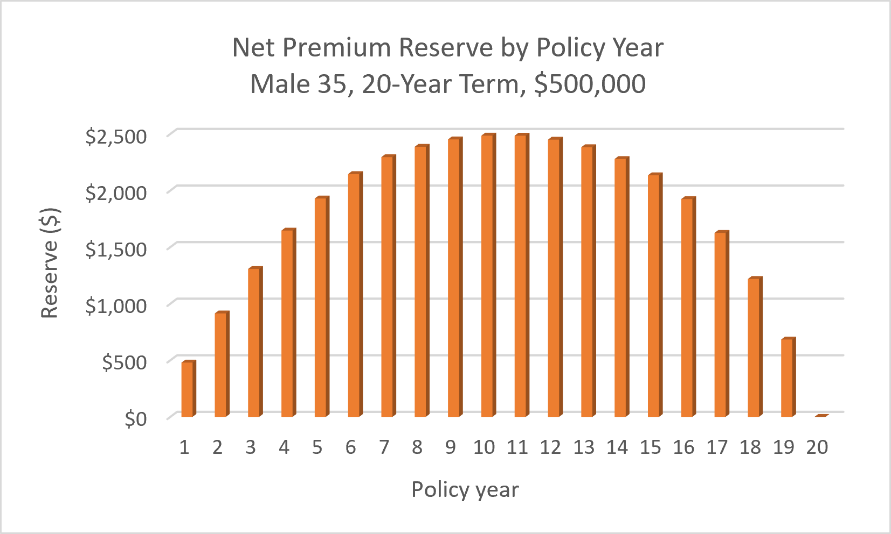
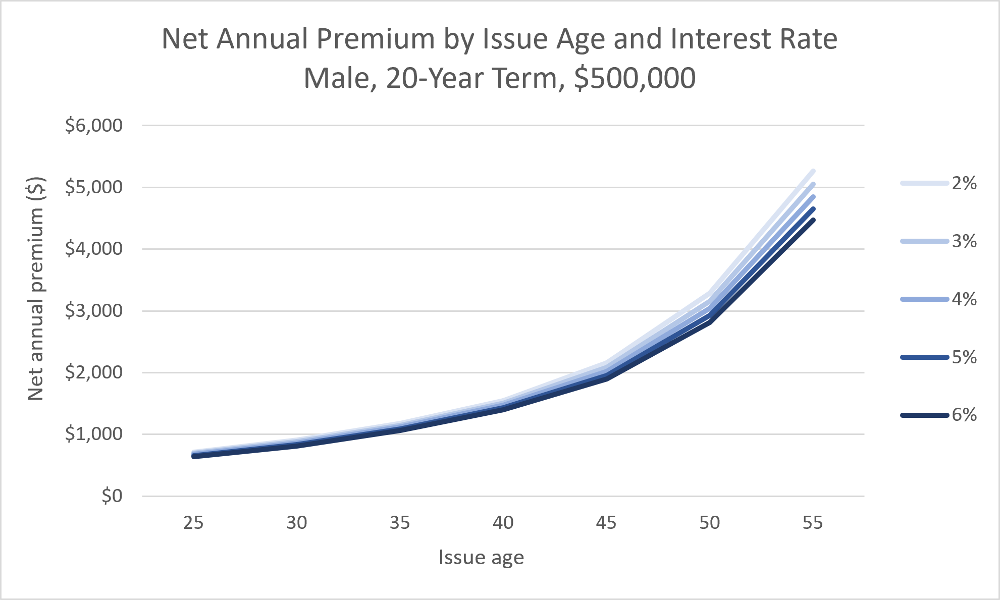
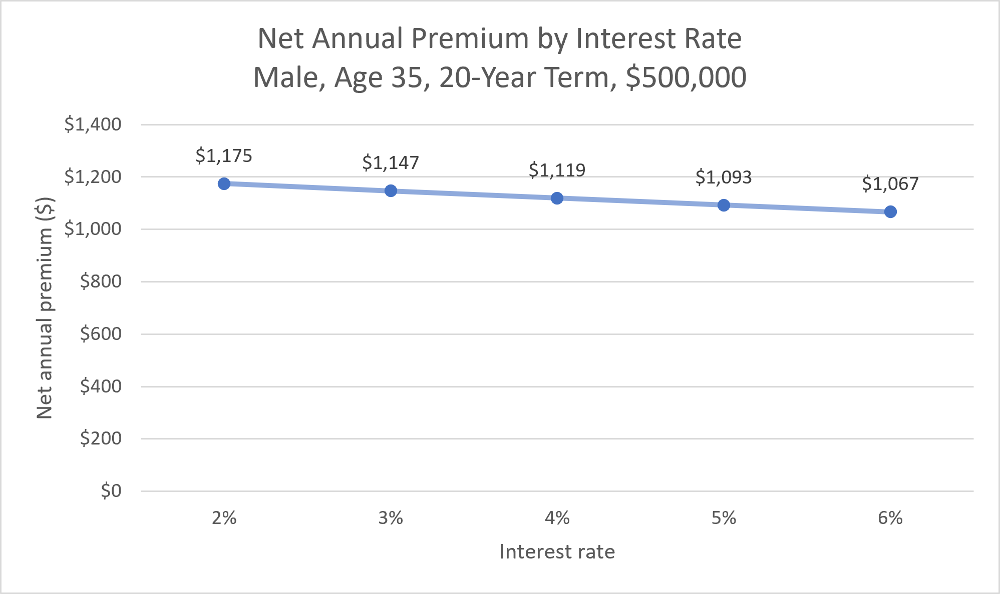

# Term Life Insurance Pricing in Excel: Net Premiums and Reserves

This Excel project prices a level term life insurance policy using the 2017 CSO mortality table. You choose the gender, issue age, term, face amount, and interest rate, and the workbook calculates the net premium and the reserve the insurer must hold each year.

[Download the Excel workbook](Term_Life_Pricing.xlsm)

**Data**

I used the Society of Actuaries' [2017 Commissioners Standard Ordinary (CSO) Tables](https://www.soa.org/resources/experience-studies/2015/2017-cso-tables), specifically the 2017 Loaded CSO Composite Ultimate tables for males and females, age nearest birthday (ANB). The CSO is the standard table US regulators require for life insurance reserves.

The SOA file splits each table into two halves (ages 0-60 and 61-120) and gives rates per 1,000 people. Using Power Query, I stacked the halves, converted the rates to probabilities, and merged the male and female tables into one table with a row for each age.

**Method**

<ins>Inputs</ins>

We set the base case as a 35-year-old male, 20-year term, \$500,000 face amount, at 4% interest. Dropdowns limit the inputs to valid choices (ages 18-70 with terms of 10, 15, 20, or 30 years), and named cells keep the formulas readable. Premiums are paid at the start of each year, and the death benefit is paid at the end of the year of death.

<ins>Projection</ins>

For each policy year, I used the XLOOKUP function to pull the probability of death for that age and gender, then calculated the probability of being alive at the start of the year and of dying during it. A 1/0 "in term" column switches off benefits and premiums after the term ends, so one table can handle any term.

<ins>Net premium</ins>

The net premium is the expected present value (EPV) of the death benefits divided by the EPV of \$1 of premium, which is the premium that makes expected premiums equal expected benefits.

<ins>Reserves</ins>

Each year starts with the reserve plus the premium, which grows with a year of interest. The expected death claims are then paid, and the rest is divided among the survivors. As a check, the reserve must come back to \$0 at the end of the term, since the policy pays nothing after that.

<ins>Sensitivity and scenarios</ins>

A two-way data table recalculates the premium for every combination of issue age and interest rate, and Goal Seek works backward from a target premium. A VBA macro runs seven policies through the model, records each premium and peak reserve, and restores the original inputs.

**Results**

| Base case              |      Result |
|------------------------|------------:|
| Net annual premium     |  \$1,119.23 |
| EPV of death benefits  | \$15,556.58 |
| Peak reserve (year 10) |  \$2,484.98 |
| Reserve at end of term |      \$0.00 |

The reserve builds up in the early years because the level premium is more than that year's expected claims, then gets used up in the later years when death rates are higher than the premium covers.

| Issue age |      2% |      4% |      6% |
|----------:|--------:|--------:|--------:|
|        25 |   \$716 |   \$677 |   \$643 |
|        35 | \$1,175 | \$1,119 | \$1,067 |
|        45 | \$2,160 | \$2,020 | \$1,894 |
|        55 | \$5,262 | \$4,847 | \$4,472 |

\*Male, 20-year term, \$500,000. The full table in the workbook covers ages 25-55 and rates of 2%-6%.

Premiums nearly double from age 35 to 45, while moving the interest rate from 2% to 6% changes them by about 9% at age 35 and 15% at age 55.

On a scale starting at \$0, the age-35 premium barely moves across interest rates, falling only about \$108 a year from 2% to 6%. Goal Seek shows the interest rate would have to rise to around 8.8% to bring the base premium down to \$1,000.

**Scenarios**

| Scenario                   | Net premium | vs. base | Peak reserve | vs. base |
|----------------------------|------------:|---------:|-------------:|---------:|
| Base case                  |  \$1,119.23 |        – |   \$2,484.98 |        – |
| Shorter term (10 years)    |    \$922.69 |     -18% |     \$816.59 |     -67% |
| Longer term (30 years)     |  \$1,494.48 |     +34% |  \$12,068.26 |    +386% |
| Older insured (age 45)     |  \$2,020.20 |     +80% |   \$8,436.82 |    +240% |
| Smaller policy (\$250,000) |    \$559.61 |     -50% |   \$1,242.49 |     -50% |
| Higher interest (6%)       |  \$1,067.10 |      -5% |   \$2,437.58 |      -2% |
| Female                     |    \$678.14 |     -39% |   \$2,352.22 |      -5% |

**Findings**

We see consistently that age matters most. When we issue at 45 instead of 35, it raises the premium by 80%. A 30-year term costs 34% more per year than a 20-year term, but its peak reserve is almost 5 times larger, since the level premium overcharges for longer in the early years to pay for much higher death rates in the 60s. The female premium is 39% lower, but the peak reserve is only 5% lower, since reserves depend on how steeply death rates rise over the term, not just how high they are. Interest has a modest effect, so the cost of term insurance comes mostly from mortality, not discounting.

**Files**

- `Term_Life_Pricing.xlsm`: the full workbook (info, inputs, mortality, projection, reserves, sensitivity, scenarios, and summary)
- `README.md`: this page
- `reserve_chart.png`, `sensitivity_age.png`, `sensitivity_interest.png`: charts used in the report

<ins>To rerun it</ins>

1.  Open the workbook and change the blue cells on the Inputs tab. The premium, reserves, and charts update automatically.
2.  The data table on Inputs recalculates on its own. If Excel slows down, set Formulas → Calculation Options → Automatic Except for Data Tables, and press F9 to update it.
3.  To run the scenario macro, Excel needs permission first, since it blocks macros in files downloaded from the internet. Right-click the file → Properties → check Unblock → OK, then reopen it, click Enable Content, and click Run on the Scenarios tab.

**Limitations**

These are net premiums only, so there are no expenses, commissions, profit, or policyholders cancelling, and real premiums would be higher. The loaded CSO is a regulatory valuation table with a built-in safety margin, while pricing would normally use the company's own expected mortality. The composite, ultimate rates don't separate smokers and nonsmokers or reflect the lower death rates of newly underwritten policyholders. The model uses only one fixed interest rate with annual premiums.

**What's next**

We can add expenses and lapses to calculate a gross premium, and use the smoker-specific or select-and-ultimate CSO tables. We can also extend the model to whole life insurance or an annuity.
